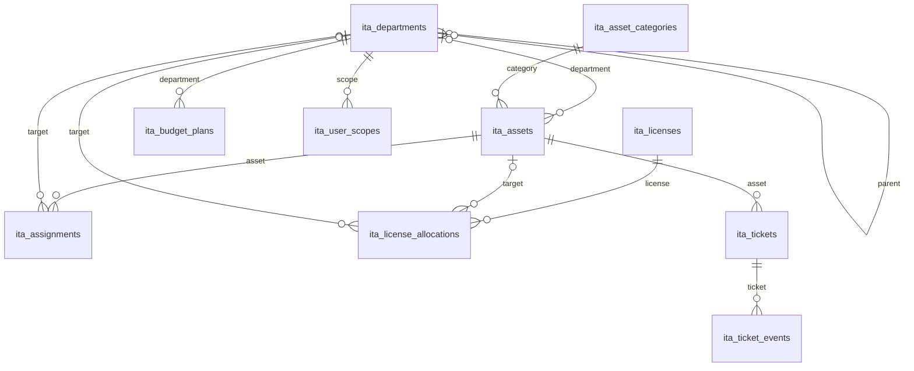

# ERD nguồn — các bảng ITA hiện có

Đối chiếu tĩnh migrations 001–005 ngày 19/10/2026; không truy vấn DB. Có 15 bảng ITA, 12 khóa ngoại nội bộ. Mọi FK ghép store_id và ID đích để giữ tenant. Đây là mô hình từ source, không xác nhận schema host đồng bộ toàn bộ.

| Bảng | Khóa và mục đích |
|---|---|
| ita_departments | id PK, unique store/code và store/id; cây bộ phận |
| ita_asset_categories | id PK, unique store/code; loại, tuổi thọ/chu kỳ/giá thay thế mặc định |
| ita_settings | PK store/setting_key; cấu hình tenant |
| ita_assets | id PK, unique store/code; hồ sơ, trạng thái, soft delete |
| ita_licenses | id PK; giấy phép, key mã hóa, số chỗ |
| ita_license_allocations | id PK; cấp phát theo một đích máy/người/bộ phận |
| ita_assignments | id PK; bàn giao, thu hồi, generated column bảo vệ active duy nhất |
| ita_tickets | id PK; phiếu hỗ trợ và chi phí |
| ita_ticket_events | id PK; chuyển trạng thái ticket |
| ita_audit_logs | id PK; actor/entity và snapshot before/after |
| ita_budget_plans | id PK; kế hoạch năm/bộ phận, snapshot |
| ita_import_batches | id PK; trạng thái/đếm dòng/staging private |
| ita_user_roles | PK store/user; vai trò ITA, enabled, revision |
| ita_user_scopes | PK store/user/department; scope active |
| ita_login_limits | PK store/bucket_hash; rate limit HMAC |

dc_users có sẵn là MyISAM, id int có dấu: kiểm user/actor ở ứng dụng, không FK hoặc đổi engine. Role ITA tách PM, mọi truy cập gắn store. Settings/audit/import/limiter không có entity FK do thiết kế cấu hình/log hoặc nhiều loại đích.

Hồ sơ/danh mục tách khỏi sự kiện và cấp phát; audit/budget snapshot cố ý giữ lịch sử. Sơ đồ không thay chứng nhận 3NF hoặc nghiệm thu DB. Phase 13 chưa có network_links. User đối chiếu DDL host khi test thủ công sau.
